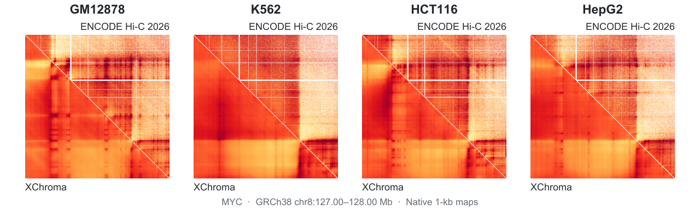

# XChroma

High-resolution, cell-type-specific 3D genome prediction and in silico mutagenesis.

XChroma predicts a 1-Mb contact map at 1-kb resolution from DNA sequence and chromatin accessibility. The same contact model can be applied to new cell types without retraining.

**DNA-only prediction and in silico mutagenesis.** [xatac](xatac/) learns sequence-to-accessibility mappings from experimental ATAC-seq, with one model per cell type. Its predicted accessibility, together with the DNA sequence, supplies the frozen XChroma model to predict how sequence edits alter genome folding in that cellular context.

## Zero-shot prediction across human cell types

<p align="center">
  
</p>

These examples use DNA and experimental ATAC-seq with the same contact model across four human cell types. They show a **1-Mb interval at the MYC locus** at native **1-kb resolution**, with **ENCODE Hi-C (2026)** contacts above the diagonal and **XChroma** predictions below it.

## Predict a contact map from DNA and ATAC

Install the inference dependencies and download the [model weights](https://github.com/ahansenlab/XChroma/releases/tag/main-model-avg10-30500-35000):

```bash
python -m pip install -r xtrain/requirements-inference.txt
gh release download main-model-avg10-30500-35000 \
  --repo ahansenlab/XChroma --pattern '*.ckpt.pt' --dir weights
python -m xtrain.checkpoints.verify --weights-dir weights
```

Supply a matching reference genome and chromatin-accessibility input:

```bash
python -m xtrain.predict \
  --genome-fa /path/to/hg38.fa \
  --atac-dir /path/to/cell_atac \
  --assembly hg38 \
  --region chr8:127000000-128000000 \
  --weights-dir weights \
  --device cuda \
  --out outputs/MYC.dna-atac
```

The output is a 1,000 × 1,000 contact map in `prediction.npz`, at 1-kb resolution. Use `--device cpu` for CPU inference. See the [inference guide](xtrain/GETTING_STARTED.md) for input formats and output values.

## Predict a contact map from DNA only

Use a cell-specific **xatac** model to predict accessibility, then pass its output
and the same DNA sequence to **XChroma**. The contact model and weights are the same
as above.

Download the ten-member GM12878 ensemble from the
[pretrained xATAC release](https://github.com/ahansenlab/XChroma/releases/tag/xatac-avg10-20261102)
into a new, cell-specific directory, then predict accessibility with its fixed
training calibration. Use the matching indexed hg38 reference FASTA. See the
[xatac guide](xatac/README.md#pretrained-ensembles) for checksum verification,
other cell types and the scope of each calibration.

```bash
python -m pip install -r xatac/requirements.txt
gh release download xatac-avg10-20261102 --repo ahansenlab/XChroma \
  --pattern 'XChroma_xATAC_gm12878_step*.pt' \
  --pattern xatac_models.json --pattern SHA256SUMS --dir weights/xatac/gm12878
python -m xatac.predict \
  --checkpoint weights/xatac/gm12878/XChroma_xATAC_gm12878_step*.pt \
  --fasta /path/to/hg38.fa --assembly hg38 --chrom chr8 \
  --start 127000000 --end 128000000 \
  --xchroma-scale 1062.9903291441547 --gp99 6.207031 \
  --device cuda --output outputs/MYC.atac.npz
```

Then predict the contact map:

```bash
python -m xtrain.predict \
  --genome-fa /path/to/hg38.fa \
  --atac-npz outputs/MYC.atac.npz \
  --assembly hg38 \
  --region chr8:127000000-128000000 \
  --weights-dir weights \
  --device cuda \
  --out outputs/MYC.dna-only
```

The DNA-only map is saved as `outputs/MYC.dna-only/prediction.npz`. The predicted
accessibility is already normalized for XChroma; this command uses it directly.

For CPU inference, replace `--device cuda` with `--device cpu --threads 8`
in both commands. Verified 1-Mb DNA-only examples took 6.0–6.4 min
with eight CPU threads on Linux, after reference-context preparation.
